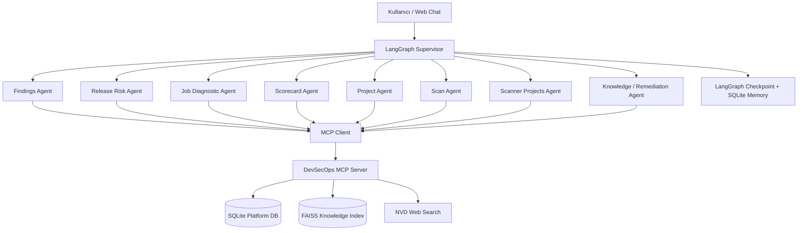
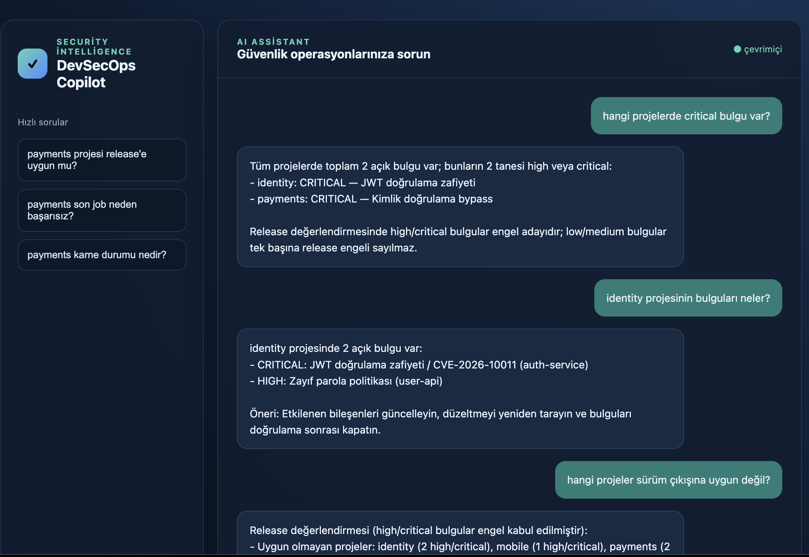
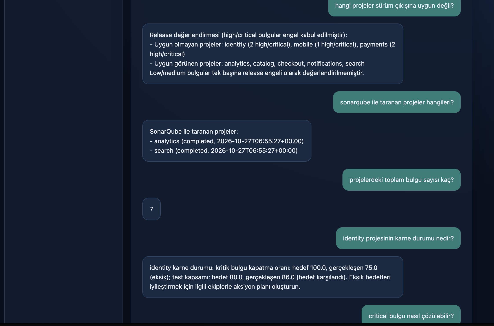
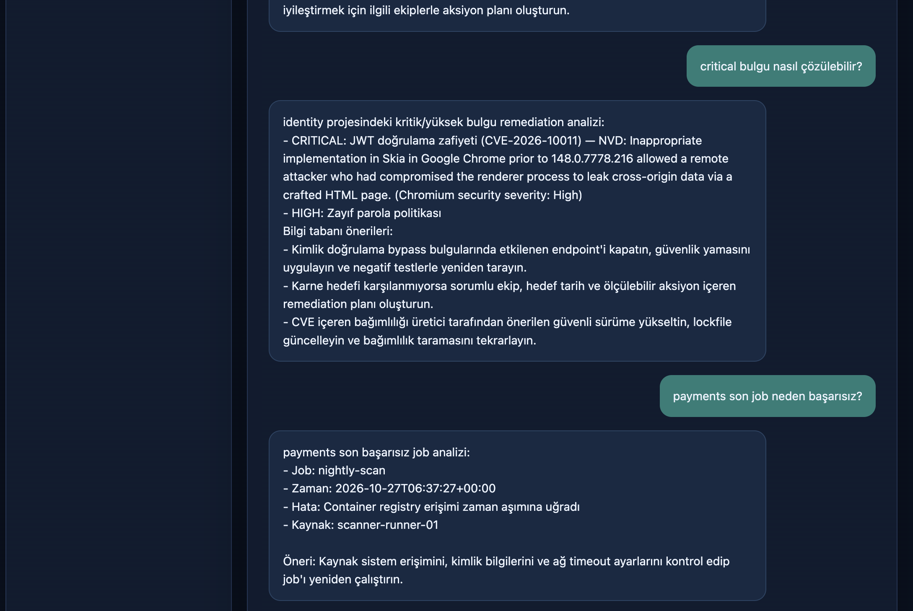
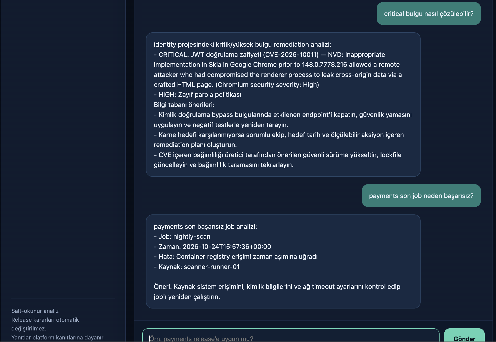

# DevSecOps Copilot

> Agentic AI Bootcamp — Kapanış Projesi

DevSecOps Copilot; güvenlik taramalarının sonuçlarını, bulguları, release kararlarını, karne hedeflerini ve scheduled job loglarını doğal dille analiz eden çoklu agent uygulamasıdır.

## 1. Problem ve amaç

DevOps güvenlik platformlarında bilgi; scan sonuçları, scanner detayları, CVE kayıtları, release kararları, ekip karne hedefleri ve job logları gibi farklı kaynaklara dağılır. Kullanıcı bu kaynakları tek tek incelemek yerine chat arayüzünden soru sorabilmelidir:

- Hangi projelerde kritik veya yüksek bulgu var?
- Sonarqube ile hangi projeler tarandı?
- Hangi projeler release için uygun değil?
- Bir job neden başarısız oldu?
- Bir kritik bulgu nasıl giderilmeli?
- Bir projenin karne hedefleri ne durumda?
- Bir projenin son başarılı taraması ne zaman yapıldı?

Bu problem basit bir LLM çağrısıyla çözülemez; agent’ın doğru veriyi seçmesi, birden fazla tool çağırması, sonuçları birleştirmesi, konuşma bağlamını koruması ve remediation bilgisi araması gerekir.

## 2. Agentic mimari



### Akış

1. Kullanıcı sorusu LangGraph Supervisor’a gelir.
2. Supervisor, LangChain `ChatOllama` ile uygun specialist agent’a handoff yapar.
3. Specialist agent, platform verisini MCP tool’larıyla alır.
4. Remediation sorularında FAISS knowledge store ve gerekirse NVD web araması kullanılır.
5. LangGraph kısa dönem state’i, SQLite session memory ise kalıcı konuşma geçmişini saklar.
6. Agent kanıta dayalı Türkçe yanıt üretir; release kararını otomatik değiştirmez.

### Scan ve scanner sorgularının ayrımı

- **`ScanAgent`**, proje adı verilen sorularda projenin son scan kaydındaki tarihi döndürür. Örnek: `payments projesinin son başarılı taramasının tarihi nedir?`
- **`ScannerProjectsAgent`**, belirli bir scanner adıyla taranan projeleri listeler. Örnek: `SonarQube ile taranan projeler hangileri?`
- Scanner adı, MCP üzerinden alınan geçerli scanner listesiyle doğrulanır; boş veya tanınmayan scanner değeri tüm projeleri eşleştirmez.
- Scan tarihi ve job zamanı ayrı kayıtlardan okunur. Bu nedenle başarılı bir scan ile başarısız bir job aynı işlem olarak değerlendirilmez.

## 3. Specialist agent’lar

| Agent | Sorumluluk |
|---|---|
| `SupervisorAgent` | LangGraph akışını yönetir ve specialist handoff yapar. |
| `FindingsAgent` | Belirli bir projenin bulgularını listeler. |
| `GlobalFindingsAgent` | Tüm projelerde severity bazlı bulgu analizi yapar. |
| `FindingProjectsAgent` | Açık bulgusu bulunan projeleri listeler. |
| `ScannerProjectsAgent` | Scanner bazında taranan projeleri listeler. |
| `ScanAgent` | Belirli projenin son başarılı tarama tarihini ve scan geçmişini verir. |
| `ReleaseRiskAgent` | Belirli bir projenin release riskini analiz eder. |
| `GlobalReleaseAgent` | Tüm projelerin release uygunluğunu karşılaştırır. |
| `JobDiagnosticAgent` | Başarısız scheduled job kayıtlarını teşhis eder. |
| `ScorecardAgent` | Belirli projenin karne hedeflerini inceler. |
| `GlobalScorecardAgent` | Tüm projelerin karne durumunu özetler. |
| `KnowledgeAgent` | FAISS, MCP knowledge tool ve NVD üzerinden remediation önerir. |

### ScanAgent örneği

```text
Kullanıcı: payments projesinin son başarılı taramasının tarihi nedir?
Supervisor: scan_agent
MCP tool: get_project_summary(project="payments")
Cevap: payments projesinin son başarılı tarama tarihi: <scanned_at>
```

## 4. Klasör yapısı

```text
devsecops_ai_agent/
├── agents/                 # Supervisor, state ve specialist agent'lar
├── tools/                  # MCP gateway, SQLite ve web search yardımcıları
├── mcp/                    # FastMCP server ve platform tool tanımları
├── database/               # Seed script ve SQLite çalışma verisi
├── knowledge/              # Remediation belgeleri, FAISS store ve index builder
├── memory/                 # Kalıcı SQLite conversation memory
├── web/                    # Chat UI, HTTP API ve health endpoint
├── cli/                    # Terminal giriş noktası
├── tests/                  # Specialist ve tool testleri
├── requirements.txt
└── README.md
```

## 5. Temel teknolojiler

| Teknoloji | Kullanım |
|---|---|
| Python | Uygulama dili |
| LangGraph | Supervisor graph, handoff, state ve checkpoint |
| LangChain | ChatOllama, structured output ve agent entegrasyonu |
| Ollama / Qwen3.5 | Lokal LLM |
| FastMCP | DevSecOps MCP server |
| LangChain `MCPAdapter` | MCP tool’larını LangChain’e bağlama |
| SQLite | Platform operasyonel verileri ve kalıcı memory |
| FAISS | Semantic remediation retrieval |
| sentence-transformers | Embedding üretimi |
| NVD API | CVE için güncel web araştırması |

## 6. Kurulum

Proje kökünden çalıştırın:

```bash
python3 -m venv .venv
source .venv/bin/activate
pip install -r devsecops_ai_agent/requirements.txt
cp .env.example .env  
```

Ollama modelini hazırlayın:

```bash
ollama pull qwen3.5:4b
ollama serve
```

Demo veritabanını ve FAISS index’ini oluşturun:

```bash
python3 -m devsecops_ai_agent.database.seed
python3 -m devsecops_ai_agent.knowledge.build_index
```

## 7. Çalıştırma

MCP server’ı ayrı terminalde başlatın:

```bash
source .venv/bin/activate
source .env
python3 -m devsecops_ai_agent.mcp.server
```

Web uygulamasını ikinci terminalde başlatın:

```bash
source .venv/bin/activate
source .env
python3 -m devsecops_ai_agent
```

Uygulama `.env` dosyasını otomatik yükler. Temel ayarlar:

| Değişken | Açıklama | Varsayılan |
|---|---|---|
| `OLLAMA_URL` | Ollama API adresi | `http://127.0.0.1:11434` |
| `OLLAMA_MODEL` | Kullanılacak model | `qwen3.5:4b` |
| `OLLAMA_TIMEOUT` | LLM timeout süresi | `20` |
| `OLLAMA_THINK` | Specialist reasoning | `true` |
| `OLLAMA_SUPERVISOR_THINK` | Supervisor reasoning | `false` |
| `DEVSECOPS_MCP_URL` | MCP server adresi | `http://127.0.0.1:8001/mcp` |
| `MCP_TIMEOUT` | MCP tool timeout süresi | `8` |
| `MCP_STRICT` | MCP fallback davranışı | `true` |

`.env` dosyası secret ve makineye özel ayarlar için kullanılır; repository’ye gönderilmez. Paylaşılabilir ayar şablonu `.env.example` dosyasıdır.

Tarayıcıdan açın:

```text
http://127.0.0.1:8080
```

Alternatif port:

```bash
python3 -m devsecops_ai_agent --port 8081
```

## 8. Örnek sorular

```text
hangi projelerde critical bulgu var?
identity projesinin bulguları neler?
hangi projeler sürüm çıkışına uygun değil?
sonarqube ile taranan projeler hangileri?
payments projesinin son başarılı taramasının tarihi nedir?
projelerdeki toplam bulgu sayısı kaç?
identity projesinin karne durumu nedir?
critical bulgu nasıl çözülebilir?
payments son job neden başarısız?
```

## 9. Güvenlik ve sınırlar

- Database MCP tool’ları salt-okunur çalışır.
- SQL sorguları parametrelidir.
- Agent release’i otomatik olarak block veya allow etmez.
- Web/NVD bilgisi platform kanıtından ayrı gösterilir.
- Ollama ve NVD anahtar gerektirmeden lokal/HTTP entegrasyonla kullanılır.
- MCP erişimi `MCP_STRICT=true` ile zorunlu tutulabilir.
- Hassas bilgiler kaynak koduna yazılmamalı, environment değişkenleri kullanılmalıdır.

## 10. Test ve doğrulama

```bash
source .venv/bin/activate
python3 -m unittest discover -s devsecops_ai_agent/tests -v
pip check
```

## 11. Proje görselleri

### Global critical bulgular, proje bulguları ve release analizi



Bu ekran görüntüsünde tüm projelerdeki critical bulgular, `identity` projesinin bulgu detayları ve release için uygun olmayan projeler gösterilmektedir.

### Release, SonarQube, toplam bulgu ve karne sorguları



Bu ekranda release’e uygun olmayan projeler, SonarQube ile taranan projeler, toplam açık bulgu sayısı ve `identity` karne durumu görülmektedir.

### Global bulgular ve karne cevapları



Toplam açık bulgu sayısı, tüm projelerin severity bazlı bulguları ve proje karne durumu örneklenmiştir.

### Remediation, job teşhisi ve scan tarihi



Kritik bulgu için remediation/NVD analizi, başarısız scheduled job teşhisi ve projenin son başarılı tarama tarihi gösterilmektedir.

## 12. Değerlendirme kriterleriyle eşleşme

- **Problem ve gerçek dünya uygunluğu:** Güvenlik operasyonlarındaki dağınık verilerin tek chat deneyiminde birleştirilmesi.
- **Agentic mimari:** LangGraph Supervisor, specialist agent’lar, MCP tool calling, FAISS RAG ve memory.
- **İşlevsellik:** Global/proje bazlı sorular, severity filtreleri, release analizi, job teşhisi ve CVE remediation.
- **Kod kalitesi:** Katmanlı klasör yapısı, salt-okunur tool’lar, environment tabanlı ayarlar ve testler.
- **Dokümantasyon:** Kurulum, servis başlatma, örnek sorular, mimari diyagram ve görsel teslim planı.
